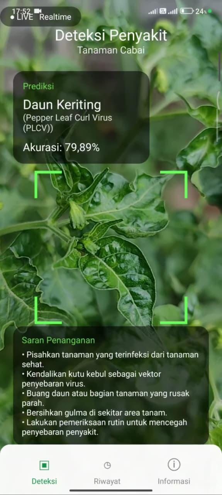
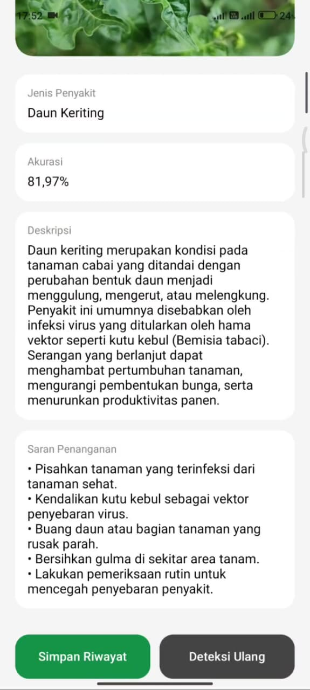
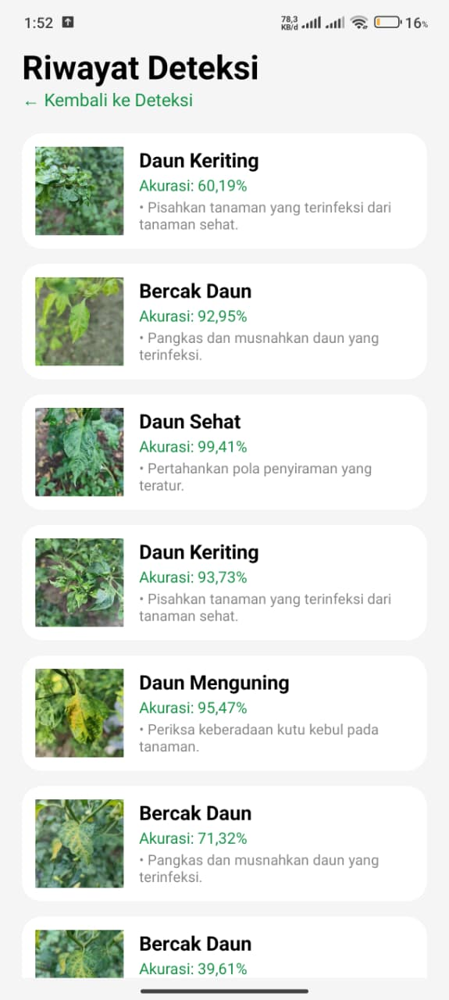
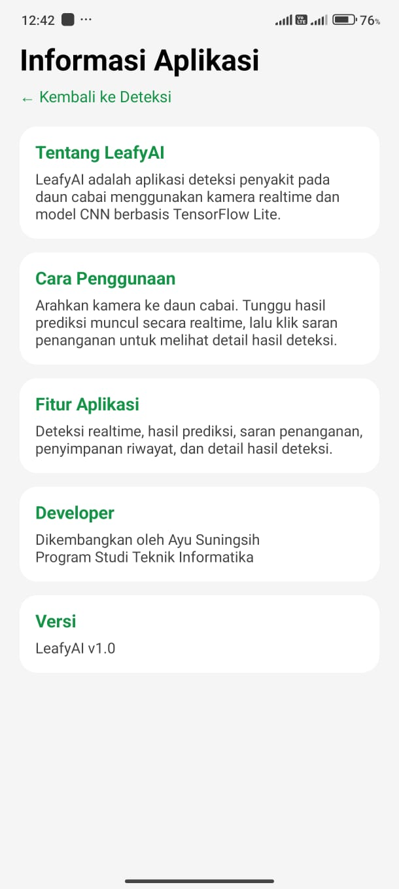

# 🌿 LeafAI — Chili Leaf Disease Detection

**LeafAI** is an Android application that detects chili leaf diseases in real time using a Convolutional Neural Network (CNN) integrated with TensorFlow Lite.

The application helps users identify potential plant diseases and provides information and treatment suggestions.

## ✨ Features

- **Real-Time Detection** — Detect chili leaf diseases using a smartphone camera.
- **CNN Classification** — Classify leaf images using a trained deep learning model.
- **Prediction Results** — Display disease names and model confidence scores.
- **Disease Information** — View disease descriptions and treatment suggestions.
- **Detection History** — Save and review previous detection results.
- **History Details** — View images and complete prediction information.
- **Automatic History Cleanup** — Remove saved detection records after 14 days.
- **App Information** — Access usage instructions and application details.

## 🛠️ Tech Stack

| Technology | Purpose |
|---|---|
| Kotlin | Android development |
| Jetpack Compose | User interface |
| CNN | Disease classification |
| TensorFlow Lite | On-device model inference |
| CameraX | Real-time camera preview |
| Gradle | Build system |

## 📱 App Screenshots

| Detection | Prediction Result | History |
|:---:|:---:|:---:|
|  |  |  |

| History Detail | App Information |
|:---:|:---:|
|  |  |

## 🚀 How to Run

1. Clone the repository:
   `git clone https://github.com/aysns/LeafAI.git`
2. Open the project in Android Studio.
3. Sync the Gradle dependencies.
4. Connect an Android device or start an emulator.
5. Run the application and grant camera permission.

## 📌 Project Status

**Functional Android Prototype**

Core features have been implemented and manually tested.

## 👩‍💻 Developer

**Ayu Suningsih**

GitHub: [@aysns](https://github.com/aysns)

---

**LeafAI — Smarter Chili Leaf Disease Detection.** 🌿
